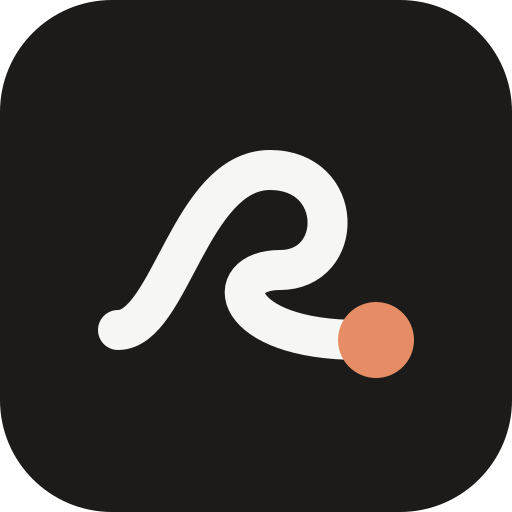

<p align="center"></p>

<h1 align="center">Followthrough</h1>
<p align="center">Every ask, answer, and follow-up in one place.<br>所有请求、答复和待跟进，都在一处。</p>

<p align="center">
  <a href="https://github.com/xfshan1014-boop/followthrough/releases/latest"><b>Download for Mac</b></a> ·
  <a href="https://xfshan1014-boop.github.io/followthrough/"><b>Try it in your browser</b></a>
</p>

---

Followthrough is a tracker for work that runs through other people: the asks you sent,
the answers you're waiting on, the questions you still need to ask, and what you promised in
your last meeting. It started as the tool I built for myself as a product manager intern and
works for anyone who coordinates with other teams: product, operations, design, marketing,
program management.

## What it does

- **Today**: your next actions first, then who you're waiting on (and for how many days),
  new answers, and the questions you still need to ask.
- **Tasks**: every task with its next step, priority, status, who it depends on, and due date.
- **Questions**: everything you need to ask, by person, with an agenda for your next 1:1.
- **Capture**: record a meeting (on-device transcription in the Mac app) or paste a transcript.
  AI proposes board updates (answers, next steps, waiting-ons, new questions) and nothing changes
  until you accept them.
- **English and 中文**, switchable anytime. A sample week for your role to look around first.

The Mac app adds what a browser tab can't: keep it on top of other windows, open it from the
menu bar, and launch it at login.

## Your data stays with you

- Your board lives on your computer: plain files in `~/Library/Application Support/Followthrough`
  for the Mac app, browser storage on the web. No account, no sync, no analytics.
- The only thing ever sent to a server is the email you sign up with, so I know how many people use it.
- AI is optional and uses **your own API key** with the provider you choose (Anthropic, OpenAI,
  Google Gemini, DeepSeek, OpenRouter, or any OpenAI-compatible endpoint). Requests go straight from
  your computer to that provider. Your key stays on your computer.
- Transcription in the Mac app uses Apple's on-device speech recognition. In a browser, the
  browser's own speech service is used, which may send audio to its provider (for example Google in Chrome).
- The web version ships a security policy that only lets the page contact the AI providers above.
- Export or erase everything anytime in Settings.

## Install the Mac app

1. Download `Followthrough-<version>-mac.zip` from [Releases](https://github.com/xfshan1014-boop/followthrough/releases/latest) and unzip it.
2. Move `Followthrough.app` to your Applications folder.
3. First launch: **right-click the app and choose Open**. The app is open source but not signed
   with a paid Apple Developer certificate, so macOS asks once.

Requires macOS 13 or later, Apple silicon or Intel.

## Build it yourself

You need Node and the Xcode Command Line Tools (`xcode-select --install`). No other dependencies.

```bash
node scripts/build.mjs      # builds the web version into docs/
./mac/build.sh              # builds dist/Followthrough.app and a release zip
```

| Path | What it is |
|---|---|
| `src/tracker.html` | The board: Today, Tasks, Questions, Capture |
| `src/platform.js`, `src/platform.css` | Onboarding, settings, AI providers, import/export, transcription, Chinese UI |
| `src/samples.js` | Sample weeks for each role |
| `mac/Sources/main.swift` | The native Mac app: window, menu bar, on-device speech, file storage |
| `scripts/build.mjs` | Builds the web version and the page bundled in the Mac app |
| `tests/` | Self-tests you load into the running page (see the comment at the top of each file) |
| `design/previews/` | The clickable design previews compared before building |

## Make it yours

If it helps you, fork it and change anything to fit how you work: rename the stages, add your
team's roles, or point it at your own AI endpoint.

## Credits

Designed by Justin Shan, built with Claude Code. Fonts: [Geist](https://github.com/vercel/geist-font)
and [Newsreader](https://github.com/productiontype/Newsreader), both under the SIL Open Font License.

Code under the [MIT License](LICENSE).
